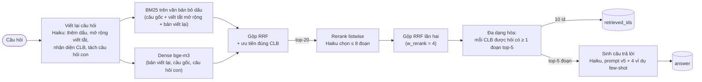

<div align="center">


# Hỏi đáp cộng đồng S2B bằng RAG

Hệ thống Retrieval-Augmented Generation trả lời câu hỏi về CLB Lập Trình PTIT (ProPTIT), CLB Multimedia PTIT (MPC)
và CLB Nhà Sáng Tạo Game PTIT (GCC), bài dự thi NeoRAG Cup 2026.

<p>  </p>

</div>

**Kết quả:** Public Test **88.95** (baseline 52.40, +36.6 điểm). Truy xuất 93.80, sinh câu trả lời 84.09. Mỗi câu hỏi
dùng 3 lời gọi `claude-haiku-5-5`, chi phí ≈ $0.0017 và độ trễ ≈ 8 giây.

Thể lệ, lịch và cách chấm của cuộc thi nằm ở [docs/cuoc-thi.md](docs/cuoc-thi.md).

## Mục lục

1. [Kết quả](#1-kết-quả)
2. [Kiến trúc](#2-kiến-trúc)
3. [Các quyết định kỹ thuật](#3-các-quyết-định-kỹ-thuật)
4. [Cài đặt](#4-cài-đặt)
5. [Chạy pipeline và tái tạo kết quả](#5-chạy-pipeline-và-tái-tạo-kết-quả)
6. [Chatbot](#6-chatbot)
7. [Cấu trúc repository](#7-cấu-trúc-repository)
8. [Hạn chế](#8-hạn-chế)

## 1. Kết quả

Điểm = 0.5 × truy xuất (Recall@5, MRR@5, NDCG@5) + 0.5 × sinh câu trả lời (String Presence, ROUGE-L, Groundedness,
Response Relevancy, 1 − Noise Sensitivity, Abstention). Chi tiết: [docs/evaluation.md](docs/evaluation.md).

| Phiên bản | Thay đổi chính | Public Test | Truy xuất | Sinh |
|---|---|---:|---:|---:|
| E0 | Baseline của BTC: dense bge-m3 top-5, prompt tối giản | 52.40 | 42.31 | 62.48 |
| E3 | Viết lại câu hỏi + hybrid BM25/dense (RRF) + few-shot | 80.09 | 82.19 | 77.98 |
| E4 | Tách câu hỏi con theo CLB + prompt trả lời ngắn | 82.28 | 82.68 | 81.89 |
| E5 | Từ điển viết tắt PTIT, phân giải chữ không dấu | 83.55 | 83.67 | 83.43 |
| E6 | Synthetic Question Anchors + few-shot động | 82.84 ↓ | 82.87 | 82.80 |
| **E7** | **E5 + rerank listwise bằng Haiku** | **88.95** | **93.80** | **84.09** |

Chi tiết E7 trên Public Test: Recall@5 91.59 · MRR@5 97.62 · NDCG@5 92.20 · String Presence 88.46 · ROUGE-L 58.50 ·
Groundedness 100 · Relevancy 60.17 · 1 − Noise 97.44 · Abstention 100.

Trên bộ train (126 câu, có judge), E7 đạt 92.36. Mọi lần chạy, kể cả những lần thất bại, đều ghi trong
[docs/experiments.md](docs/experiments.md) kèm commit SHA, metric và chi phí.

## 2. Kiến trúc



| Bước | Module | Lời gọi gateway |
|---|---|---|
| Viết lại câu hỏi | [`src/solution/query.py`](src/solution/query.py) | 1 chat |
| BM25 + dense + RRF + ưu tiên CLB | [`src/solution/retrieval.py`](src/solution/retrieval.py), [`bm25.py`](src/solution/bm25.py), [`textproc.py`](src/solution/textproc.py) | embedding câu hỏi |
| Rerank listwise | [`src/solution/rerank.py`](src/solution/rerank.py) | 1 chat |
| Sinh câu trả lời | [`src/solution/prompts.py`](src/solution/prompts.py) | 1 chat |
| Ghép pipeline, cấu hình `RAG_*` | [`src/solution/pipeline.py`](src/solution/pipeline.py) | |
| Chống lỗi gateway, output luôn hợp lệ | [`src/solution/resilience.py`](src/solution/resilience.py) | |
| Trace và stream cho chatbot | [`src/solution/trace.py`](src/solution/trace.py), [`app/api.py`](app/api.py) | |

Tài liệu đầy đủ (luồng dữ liệu, cấu hình, cache, xử lý lỗi, chi phí): [docs/architecture.md](docs/architecture.md).

## 3. Các quyết định kỹ thuật

Mỗi quyết định đều có số liệu ablation, đo bằng `python -m solution bench` (truy xuất) hoặc
`neorag run train --no-judge` (sinh câu trả lời).

| Quyết định | Vì sao | Tác dụng đo được |
|---|---|---|
| Viết lại câu hỏi bằng Haiku | 26/126 câu train viết không dấu hoặc viết tắt (`dpt`, `mm`, `hv`); baseline chỉ đạt Recall@5 0.44 ở nhóm này | Viết lại + hybrid (E0 → E1): truy xuất train 72.2 → 85.7 |
| BM25 trên văn bản **bỏ dấu** | Câu hỏi không dấu vẫn khớp từ khóa với tài liệu có dấu | Một trong hai nguồn tín hiệu của RRF |
| Gộp bằng **RRF** thay vì cộng điểm | BM25 và cosine khác thang đo; RRF chỉ dùng thứ hạng nên không cần chuẩn hóa | Ổn định khi đổi trọng số |
| Tách câu hỏi con theo từng CLB | Câu so sánh cần đoạn của cả hai CLB | Truy xuất +2.0 (E4) |
| **Rerank listwise bằng Haiku** | Đọc câu hỏi cùng 20 ứng viên một lúc, phân biệt đúng CLB, đối tượng, mốc thời gian | Public +5.4 (truy xuất +10.1), lớn nhất cả dự án (E7) |
| Prompt trả lời ngắn + few-shot tĩnh | Đáp án chuẩn dài ~200 ký tự; câu dài làm giảm ROUGE-L và tăng Noise | ROUGE-L Public 52.96 → 60.87 (E3 → E4) |
| Từ chối theo một câu chuẩn | Câu không có trong tài liệu (~8%) phải nói rõ là không có thông tin | Abstention 100 trên Public |
| Không chunking | Mỗi đoạn trong corpus (~380 ký tự) đã tự đủ ngữ cảnh, và metric chấm theo id đoạn gốc | |

Đã thử nhưng **không giữ**, vì tăng trên train mà không tăng trên Public, hoặc trượt tiêu chí đặt trước:

| Thử nghiệm | Kết quả | Bài học |
|---|---|---|
| E6: anchors (Haiku sinh câu hỏi giả định cho từng đoạn) + few-shot động | Train +3.2, **Public −0.7** | Tối ưu theo train dễ overfit; chỉ tin cải tiến không dựa vào train |
| E8: mở rộng tập ứng viên rerank 20 → 30 | Bộ stress chỉ +0.2 (tiêu chí +1) | Pool 20 đã chứa 98% đoạn đúng |
| E9: prompt theo khuôn câu của đáp án chuẩn | ROUGE-L +2.1 nhưng Groundedness −2.2 | Tăng metric chép chữ đổi lấy giảm metric judge |
| E10: bộ đo hard-dev sinh từ corpus | Không khó hơn train (98.68 so với 98.59) | Câu hỏi do LLM sinh từ chính tài liệu thì quá dễ cho reranker LLM |

## 4. Cài đặt

Cần Python 3.10 trở lên và key gateway do BTC cấp. Không cần GPU: cả LLM lẫn embedding bge-m3 đều gọi qua gateway.

```bash
git clone https://github.com/trieuwu/NeoRAG-Cup-2026.git && cd NeoRAG-Cup-2026
python -m venv .venv
.venv\Scripts\Activate.ps1            # macOS/Linux: source .venv/bin/activate
python -m pip install -r requirements.lock.txt && python -m pip install --no-deps -e .   # đúng phiên bản đã kiểm chứng
# hoặc bản mới nhất: python -m pip install -e ".[app,api,dev]"
copy .env.example .env                # điền key vào .env (không commit file này)
```

Hướng dẫn chi tiết về môi trường và gateway: [docs/guide.md](docs/guide.md), [docs/gateway.md](docs/gateway.md).

## 5. Chạy pipeline và tái tạo kết quả

```bash
neorag run train --no-judge --pipeline solution.pipeline:SolutionPipeline    # train: truy xuất + SP + ROUGE-L, không tốn judge
neorag run public_test --pipeline solution.pipeline:SolutionPipeline         # tạo file nộp Public
python -m solution bench [--set train|stress|harddev]                         # ablation truy xuất
python -m pytest                                                              # test offline, không cần key
```

**Private Test**, chạy bằng một lệnh từ tag `private-final`. Kịch bản đầy đủ của ngày thi nằm trong
[docs/private-day.md](docs/private-day.md).

```powershell
git checkout private-final
powershell -ExecutionPolicy Bypass -File scripts\run_private.ps1     # Linux/macOS: bash scripts/run_private.sh
```

Script kiểm tra tag, working tree và file câu hỏi; nạp cấu hình đóng băng [`configs/private.env`](configs/private.env);
chạy; validate; sanity check so với lần chạy tham chiếu; rồi xuất `outputs/private_<HHMM>.zip`.

**Tái tạo đúng file đã nộp.** Haiku không cho phép đặt temperature nên kết quả thay đổi giữa các lần chạy không có
cache: hai lần chạy độc lập chỉ trùng tập top-5 ở khoảng một nửa số câu. Mọi lời gọi LLM được cache trong SQLite
(`.cache/solution.sqlite`, hoặc `outputs/<bộ>_runs/<HHMM>/cache.sqlite` cho mỗi lần chạy Private). Chạy lại với cùng
cache sẽ ra kết quả trùng 100%; kiểm tra bằng
`python scripts/compare_predictions.py <file tham chiếu> <file mới>`.

Tham số pipeline đổi qua biến môi trường `RAG_*` mà không cần sửa code. Danh sách đầy đủ nằm trong docstring của
[`src/solution/pipeline.py`](src/solution/pipeline.py).

## 6. Chatbot

```bash
uvicorn app.api:app --port 8000                    # API cho giao diện (FastAPI + Server-Sent Events)
python -m streamlit run app/chat.py                # giao diện dự phòng
```

`POST /api/chat` stream từng giai đoạn (`stage`), từng phần câu trả lời (`token`), rồi gửi `done` gồm:
- câu trả lời kèm trích dẫn `[n]` trỏ tới đoạn nguồn;
- câu hỏi đã được hiểu (bản viết lại, viết tắt đã mở rộng);
- danh sách ứng viên kèm hạng BM25, dense và rerank;
- thời gian từng bước, số lời gọi LLM và chi phí ước tính.

Các endpoint khác: `GET /api/suggestions`, `GET /api/doc/{id}`, `GET /api/health`. Chế độ trích dẫn chỉ áp dụng cho
chatbot; file nộp bài đi qua `SolutionPipeline.run` và có test bảo đảm kết quả không đổi.

## 7. Cấu trúc repository

```
src/solution/      pipeline của đội: query, retrieval, rerank, prompts, pipeline, resilience, trace, bench
src/neorag/        mã của BTC (bộ chấm, CLI, baseline) — không sửa
app/               api.py (FastAPI + SSE), chat.py (Streamlit)
scripts/           run_private.ps1/.sh, sanity_check.py, compare_predictions.py, install.py
configs/           private.env (cấu hình đóng băng), sanity_reference.json, eval.toml (của BTC)
data/              corpus.jsonl (118 đoạn), train/, public_test/, solution/ (anchors, hard-dev)
docs/              architecture, experiments, strategy, private-day, git-workflow, tài liệu BTC
tests/             test offline: pipeline, mô phỏng lỗi gateway, API, sanity check
```

Quy trình Git: Conventional Commits, mỗi thay đổi một nhánh và một PR có bảng số liệu, CI chạy ruff và pytest
([docs/git-workflow.md](docs/git-workflow.md)).

## 8. Hạn chế

- **Response Relevancy (~60 trên Public) gần như chạm trần.** Metric so cosine giữa câu hỏi gốc và câu hỏi mà judge
  sinh ngược từ câu trả lời. Với câu hỏi không dấu, câu do judge sinh ra luôn có dấu, nên cosine thấp bất kể câu trả
  lời đúng hay sai. Cách "ăn" điểm (trả lời không dấu, lặp từ khóa) vi phạm quy chế nên không làm.
- **Kết quả không tất định.** Không đặt được temperature, nên mỗi lần chạy không cache là một lần rút. Cache và log
  của từng lần chạy được giữ lại để đối chiếu.
- **Phụ thuộc gateway.** Gateway lỗi thì pipeline chuyển sang thứ hạng local và trích đoạn văn: vẫn ra output hợp lệ
  nhưng chất lượng thấp hơn; sanity check báo đỏ để chạy lại.
- **Độ trễ ~8 giây mỗi câu** vì có 3 lời gọi LLM tuần tự. Chatbot giảm thời gian chờ cảm nhận bằng streaming và cache.
- Bộ đo nội bộ (train, stress, hard-dev) đều đã ở mức 97–99 điểm truy xuất, nên khó đo thêm cải tiến mà không nhìn
  vào đề Public.
