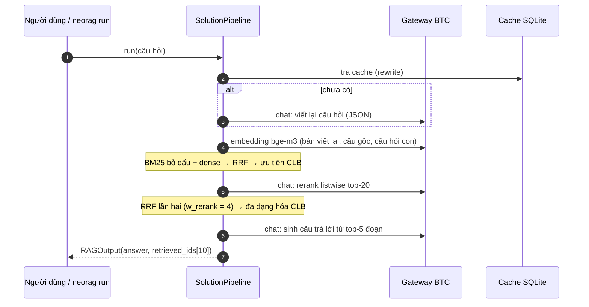
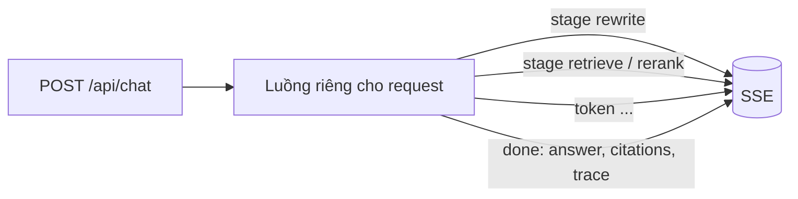

# Kiến trúc hệ thống

Tài liệu mô tả pipeline bản **E7** (Public 88.95, tag `private-final`): luồng dữ liệu, từng thành phần, cấu hình,
cache, xử lý lỗi, chi phí và phần chatbot. Số liệu thực nghiệm: [experiments.md](experiments.md).

## 1. Tổng quan

Mỗi câu hỏi tốn 3 lời gọi chat và 1 lời gọi embedding. Đo trên 42 câu Public khi cache rỗng: ≈ $0.073
(≈ $0.0017 mỗi câu), độ trễ trung vị 7–8 giây mỗi câu, cả lượt khoảng 5–6 phút. Corpus (118 đoạn) được embed một
lần lúc index và lấy từ cache ở các lần sau.

## 2. Dữ liệu và index

- `data/corpus.jsonl` có 118 đoạn ngắn (~380 ký tự), mỗi đoạn tự đủ ngữ cảnh, nên **không chunking**: metric chấm
  theo id đoạn gốc, cắt nhỏ chỉ làm mất ngữ cảnh rồi phải gộp lại.
- Văn bản đem index là `"<CLB> | <chủ đề>\n<đoạn>"`. Ghép metadata vào giúp các câu hỏi gọi tên CLB hoặc chủ đề khớp
  được ngay (`index_metadata`).
- **BM25** ([bm25.py](../src/solution/bm25.py)) chạy trên token đã **bỏ dấu**
  ([textproc.py](../src/solution/textproc.py) `fold`), gồm unigram và bigram, có danh sách từ dừng riêng. Danh sách
  này cố ý giữ lại các từ trùng với từ dừng khi bỏ dấu nhưng mang nghĩa (ban, da, chi, ho).
- **Dense**: bge-m3 qua gateway, vector chuẩn hóa L2, cosine bằng tích vô hướng.

## 3. Hiểu câu hỏi ([query.py](../src/solution/query.py))

Một lời gọi Haiku, prompt `REWRITE_SYSTEM_V3`, trả về JSON `{query, clubs, sub_queries}`:
- Thêm dấu và mở rộng viết tắt theo từ điển PTIT (`dpt`, `mm/mpc`, `hv`, `gcc`, `bcn`, `ttv`...). Từ không dấu nhiều
  nghĩa được phân giải theo ngữ cảnh, ví dụ `ve` → vẽ/về, `nhan` → nhắn/nhận, `thi` → thi/thì.
- `clubs`: CLB mà câu hỏi nhắc tới. Câu hỏi cấp Học viện thì để trống, không tự gắn CLB.
- `sub_queries`: tách ý. Câu **so sánh** được tách thành một câu hỏi con cho **từng CLB**; câu xin tư vấn thì giữ
  nguyên câu hỏi chung.

JSON hỏng hoặc thiếu trường thì `parse_plan` trả về câu hỏi gốc.

## 4. Truy xuất ([retrieval.py](../src/solution/retrieval.py))

1. **Các danh sách xếp hạng** (mỗi danh sách lấy top-30):
   - BM25 trên `fold(câu gốc) + viết tắt mở rộng + bản viết lại + câu hỏi con` (w = 1.0);
   - dense theo bản viết lại (w = 1.0), câu gốc (w = 0.2, vì câu gốc không dấu embed kém) và từng câu hỏi con (w = 0.7).
2. **RRF** (k = 60): `score(d) = Σ w / (k + hạng)`. Chỉ dùng thứ hạng nên không cần chuẩn hóa thang điểm BM25 và
   cosine.
3. **Ưu tiên CLB**: cộng `1 / k` cho đoạn thuộc CLB được hỏi, trừ khi câu hỏi nói chung về cả 3 CLB.
4. **Rerank listwise** ([rerank.py](../src/solution/rerank.py)): Haiku đọc câu hỏi (kèm các câu hỏi con) cùng 20
   ứng viên đầu, trả về `{"ranking": [id...]}` tối đa 8 id. Kết quả được gộp RRF lần hai: thứ hạng ứng viên (w = 1)
   với thứ hạng reranker (w = 4). Đoạn không được chọn giữ thứ hạng RRF. Bench w_rerank: 1 → 95.8, 2 → 98.0,
   4 → 98.8 (train).
5. **Đa dạng hóa**: câu hỏi về từ 2 CLB trở lên thì mỗi CLB có ít nhất một đoạn trong top-5. Đoạn bị thay ra là đoạn
   thấp nhất không phải đại diện của CLB nào.
6. Nộp 10 id: metric chỉ tính tại k = 5, nhưng nộp đủ 10 id không bị phạt.

## 5. Sinh câu trả lời ([prompts.py](../src/solution/prompts.py))

Prompt `v5` + 4 ví dụ few-shot tĩnh từ train, ngữ cảnh là top-5 đoạn đánh số `[i] (CLB | chủ đề)`. Các quy tắc
chính, mỗi quy tắc gắn với một metric:

| Quy tắc | Metric |
|---|---|
| Trả lời 1–2 câu, đi thẳng vào ý, không chào hỏi | ROUGE-L, Noise Sensitivity |
| Chép nguyên văn số liệu, ngày, tên riêng | String Presence |
| Mỗi câu đều có căn cứ trong tài liệu | Groundedness |
| Không có thông tin thì nói đúng một câu "Tài liệu hiện có không có thông tin về ..." | Abstention |
| Không viết câu "không có thông tin" cho điều câu hỏi không hỏi | Relevancy |

Không được chèn chỉ dẫn hay nhãn chấm vào câu trả lời (quy chế).

## 6. Cấu hình

Mọi tham số là field của `PipelineConfig` / `RetrievalConfig`, đổi bằng biến môi trường `RAG_<TÊN_FIELD>`, ví dụ
`RAG_RERANK_DEPTH=30` hoặc `RAG_PROMPT=v4`. Nhờ vậy chạy ablation không phải sửa code. Bản Private ghi tường minh
mọi giá trị E7 trong [configs/private.env](../configs/private.env). Các field không thuộc thuật toán:

| Biến | Ý nghĩa |
|---|---|
| `RAG_CACHE_PATH` | file cache SQLite của LLM (mặc định `.cache/solution.sqlite`) |
| `RAG_LOG_PATH` | file jsonl ghi log từng câu |

## 7. Cache và tính tái lập

- Mọi lời gọi LLM và embedding đi qua `neorag.llm.LLMClient`, có cache SQLite với khóa là
  `(endpoint, model, messages)`. Đổi prompt thì cache trượt, nên mọi thay đổi prompt đều được đo bằng
  `--no-judge` trước.
- Haiku không nhận tham số temperature, nên hai lần chạy không cache khác nhau: chỉ ~50% câu trùng tập top-5.
  Cache vì vậy là cách duy nhất để tái tạo đúng một file đã nộp. Ngày Private, mỗi lần chạy dùng một cache riêng và
  được sao lưu ([private-day.md](private-day.md)).

## 8. Chống lỗi ([resilience.py](../src/solution/resilience.py))

`neorag predict` của BTC không bắt exception, nên chỉ một lỗi mạng cũng làm hỏng cả lượt chạy. `SolutionPipeline.run`
được thiết kế để **không bao giờ ném exception**:

| Lỗi | Xử lý |
|---|---|
| 429, timeout, 5xx, mất kết nối | openai SDK tự thử lại; sau đó `ResilientLLM` thử lại sau 5 s và 15 s; tối đa 8 request đồng thời |
| Viết lại câu hỏi lỗi hoặc JSON hỏng | dùng câu hỏi gốc |
| Embedding lỗi | bỏ tín hiệu dense, giữ BM25 |
| Rerank lỗi, JSON hỏng, id lạ hoặc trùng | giữ thứ hạng local (RRF) |
| Sinh câu trả lời lỗi hoặc rỗng | trích 1–2 câu đầu của đoạn đứng đầu (có căn cứ, khác câu từ chối vốn bị 0 điểm Groundedness) |
| Bất kỳ lỗi nào khác | lưới an toàn: BM25 trên câu hỏi gốc |

Output luôn hợp lệ: answer 1–2000 ký tự (cắt tại ranh giới câu), 1–10 id có trong corpus và không trùng. Kết quả
dùng phương án dự phòng **không** được cache, nên chạy lại chỉ gọi lại đúng những câu đã lỗi. Mỗi câu ghi một dòng log
(`incidents`, `fallback_used`, `abstained`, độ dài, số id, latency). `scripts/sanity_check.py` so log với lần chạy
tham chiếu và báo đỏ khi có fallback hoặc khi các chỉ số lệch xa.

## 9. Chatbot ([trace.py](../src/solution/trace.py), [app/api.py](../app/api.py))

`TracedChat` chạy đúng các bước của pipeline nhưng tách từng giai đoạn để hiển thị:

- Câu trả lời được stream bằng `stream=True` của gateway. Câu đã có trong cache được trả từng từ, không tốn tiền.
- Chế độ trích dẫn thêm một quy tắc "ghi [n] cuối mỗi câu" vào prompt. Quy tắc này **chỉ** dùng trong chatbot; test
  bảo đảm tài liệu truy xuất trùng với `SolutionPipeline.run`, tức trùng bài nộp.
- `trace` gồm: câu hỏi gốc, bản viết lại, CLB, câu hỏi con, viết tắt đã mở rộng, 20 ứng viên kèm hạng BM25, dense,
  rerank và cờ được chọn, thời gian từng bước, số lời gọi LLM (bao nhiêu lời gọi trúng cache), token và chi phí
  ước tính.

## 10. Kiểm thử và quy trình

- `tests/` chạy offline, không cần key, dùng LLM và embedding giả:
  - logic truy xuất và prompt;
  - mô phỏng lỗi gateway (27 test);
  - chạy dở rồi chạy lại trên cache SQLite thật;
  - API/SSE, sanity check.
- CI (GitHub Actions): `ruff check`, `ruff format --check`, `pytest` cho mọi PR.
- Kiểm tra hồi quy trước mỗi lần merge: chạy `public_test` với cấu hình mặc định và
  `scripts/compare_predictions.py` so với file đã nộp; kết quả phải khớp 42/42.
- Git: Conventional Commits, mô tả bằng tiếng Việt, mỗi hướng thử một nhánh và một PR kèm bảng số liệu
  ([git-workflow.md](git-workflow.md)).
